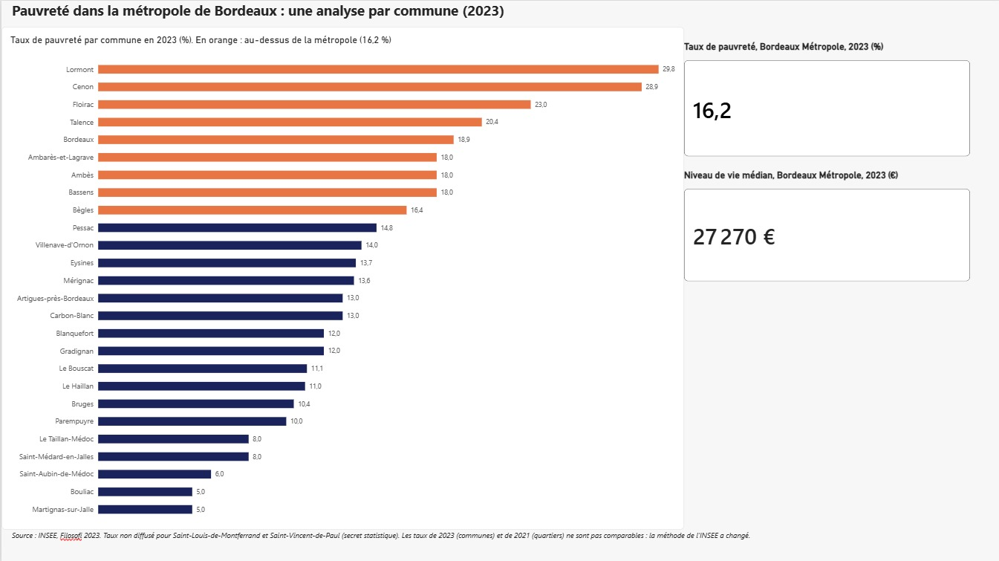
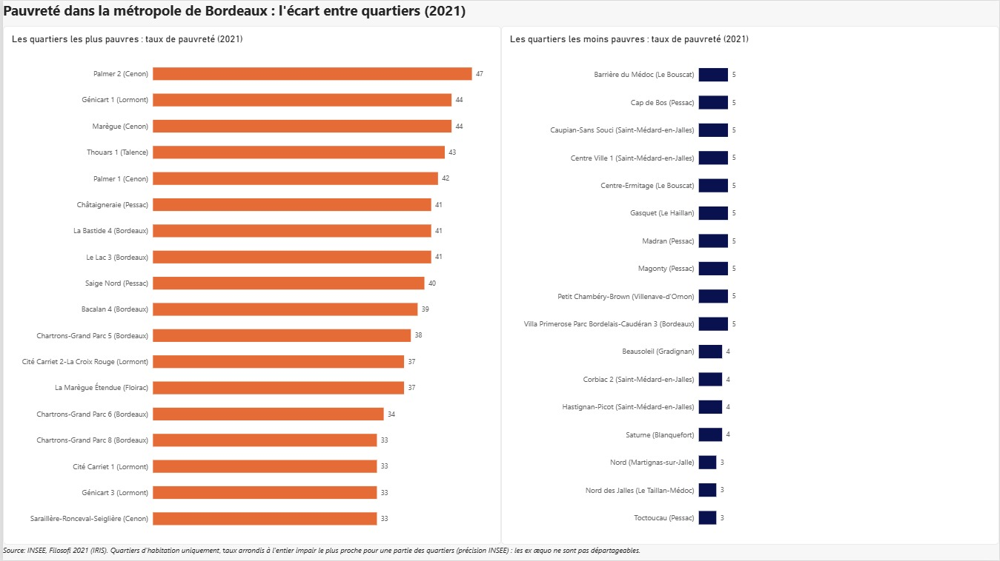
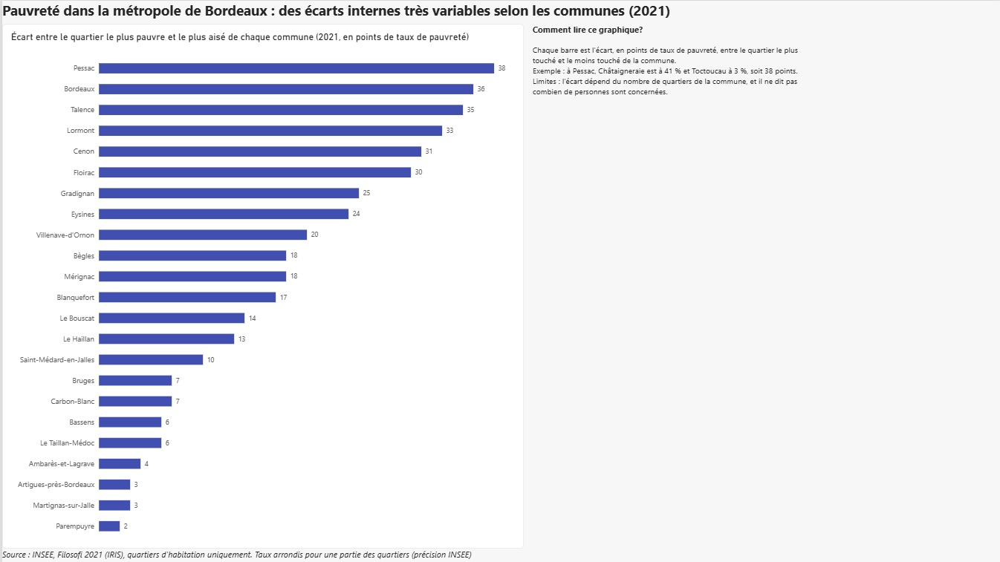
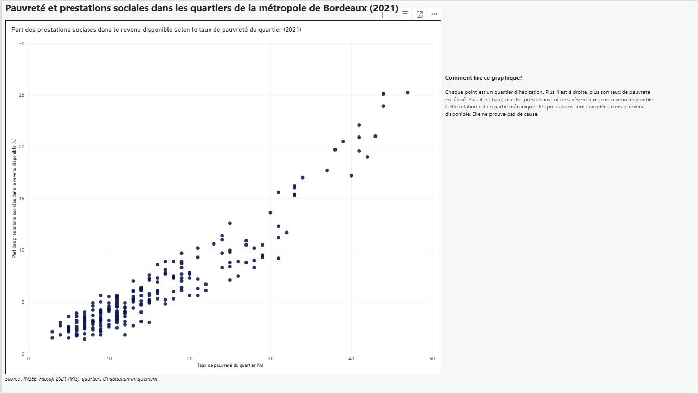

# La pauvreté dans la métropole de Bordeaux, quartier par quartier

Tableau de bord Power BI à partir des données Filosofi de l'INSEE.

## La question

Dans la métropole de Bordeaux, où se concentre la pauvreté, et à quel point les écarts entre quartiers voisins sont-ils grands ?

## Le tableau de bord, en 4 pages

1. **Vue d'ensemble** : taux de pauvreté des 28 communes en 2023, comparé à la métropole (16,2 %).
2. **Les quartiers** : les quartiers d'habitation (IRIS) les plus et les moins pauvres, en 2021.
3. **Les écarts** : pour chaque commune, l'écart en points entre son quartier le plus pauvre et le plus aisé, en 2021.
4. **Pauvreté et prestations sociales** : part des prestations sociales dans le revenu disponible selon le taux de pauvreté du quartier, en 2021.

## Résultats principaux

- Neuf communes sur vingt-huit dépassent le taux de pauvreté de la métropole (16,2 % en 2023), avec Lormont (29,8 %) et Cenon (28,9 %) en tête.
- À l'échelle des quartiers (2021), les taux vont de 3 % à 47 %.
- À Pessac, le quartier le plus touché est à 41 % et le moins touché à 3 % : 38 points d'écart. À Parempuyre, l'écart est de 2 points.
- Plus le taux de pauvreté d'un quartier est élevé, plus les prestations sociales pèsent dans son revenu disponible.

## Données

| Source | Niveau | Millésime |
|---|---|---|
| INSEE, Filosofi, revenus disponibles | IRIS (quartiers) | 2021 |
| INSEE, Filosofi 2, indicateurs locaux | Commune, EPCI | 2023 |
| INSEE, code officiel géographique | Commune vers EPCI | 2022 |

Les données brutes ne sont pas incluses dans ce dépôt : elles sont publiques sur insee.fr.

## Méthode

Épuration dans Power Query : import avec le bon encodage, identifiants en texte, filtre sur les 28 communes de la métropole, remplacement des codes INSEE de valeurs absentes (`ns`, `nd`, `so`) par des cases vides, typage des mesures, pivot, fusions, contrôles de lignes.
Modèle et visuels dans Power BI, avec des mesures DAX explicites pour les taux (jamais de somme de taux).

Contrôles : 28 communes, 272 IRIS dans 23 communes, 254 IRIS d'habitation, 16 IRIS sans taux, 2 communes sans taux en 2023 (secret statistique).

## Limites

- Ce travail **décrit**, il n'explique pas pourquoi certains quartiers sont plus touchés.
- Les taux de 2021 (quartiers) et de 2023 (communes) ne sont **pas comparables** : la méthode de l'INSEE a changé. Aucune évolution n'est calculée.
- Les taux de pauvreté de nombreux petits quartiers sont arrondis par l'INSEE (à l'entier impair le plus proche), donc les ex æquo ne sont pas départageables.
- Les quartiers de moins de 50 ménages ne sont pas diffusés.
- Les prestations sociales sont comptées dans le revenu disponible : la relation avec le taux de pauvreté est en partie mécanique et ne prouve pas de cause.

## Fichiers

- `pauvrete_bordeaux.pbix` : le rapport Power BI.
- `01_vue_ensemble.jpg` à `04_prestations.jpg` : une capture par page.

## Aperçu

## Auteur

Christophe Ago, Master 2 Économiste Analyste des Données pour le Développement, Université de Bordeaux.
